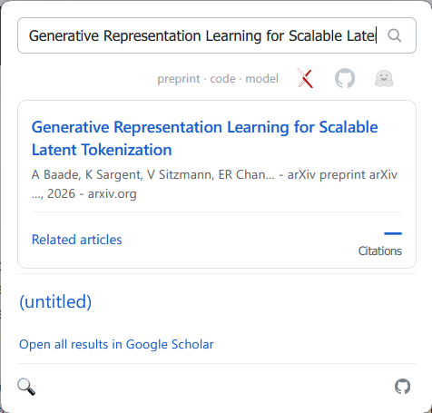
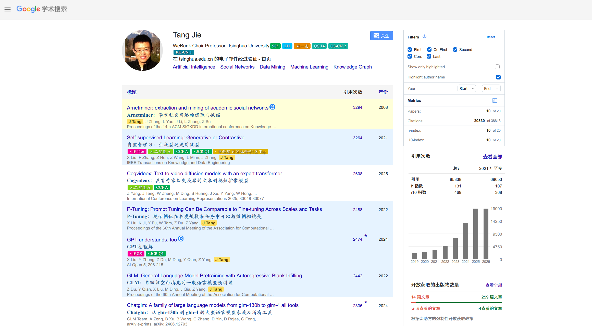

# Google Scholar Highlight Kit

A browser extension for Google Scholar: highlights papers by authorship role
on profile pages, and adds a toolbar search that looks up the current paper
across Google Scholar, arXiv, GitHub and Hugging Face.



On a paper page the popup detects the paper automatically; the badges show
where its preprint, code, and model live.

## Features

- Toolbar popup searches Google Scholar and shows results in place; on an
  arXiv or Scholar paper page it detects the paper automatically and shows a
  paper card with Cite, BibTeX, and Related-article links
- Availability badges for the detected paper: arXiv preprint, GitHub code,
  Hugging Face model — gray when absent, colored when found, click to open
- Highlights first, co-first, second, corresponding, and last-author papers
  on Scholar profile pages, with author-name marking
- Metrics for the highlighted subset (papers, citations, h-index, i10) and
  filters by role and year
- Screenshot of the filtered list (copy or download)



Works on every Google Scholar language domain, including community mirrors
that keep Scholar's DOM.

## Install

**Chrome / Chromium:** download `scholar-highlight-kit-<version>-chrome.zip`
from [Releases](../../releases), unzip, then open
`chrome://extensions`, enable *Developer mode*, click *Load unpacked*, and
select the unzipped folder.

**Zen / Firefox:** download `scholar-highlight-kit-<version>-firefox-zen.xpi`
from [Releases](../../releases). For a permanent install the package must be
signed; with an [AMO](https://addons.mozilla.org) API key:

```sh
npx web-ext sign --source-dir zen --api-key <issuer> --api-secret <secret> --channel unlisted
```

Until then, load it temporarily via `about:debugging#/runtime/this-firefox`
→ *Load Temporary Add-on*.

## Build

```sh
npx web-ext lint --source-dir zen
npx web-ext build --source-dir zen
```

The Chrome build is the same source with `background.service_worker`
instead of an event page; see `report/build_all.py`.

## Reference

Based on [Google Scholar Author Highlighter](https://chromewebstore.google.com/detail/google-scholar-author-hig/ijmngekkpaccbbjimedfkjpigplaikah)
by Yue Deng. For personal use.
